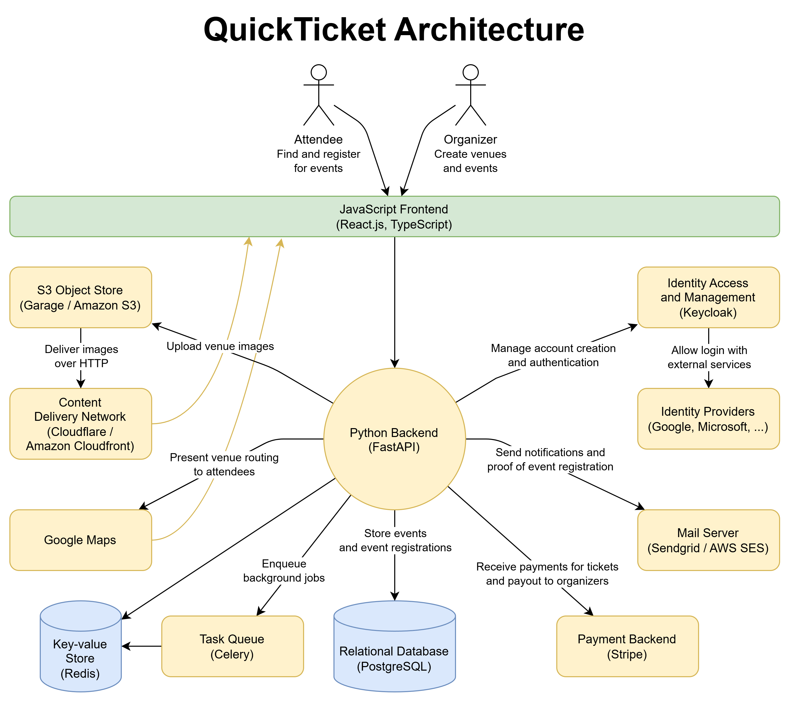

# QuickTicket

## Summary

QuickTicket is a web-based ticket sales platform for small and medium-scale events.
It allows unaffiliated organizers of small-scale venues to set up public or invite-only
events in minutes.

Attendees can browse and search through events, register through email
verification, single sign-on, or a guest flow, and receive tickets for free or
purchase tickets, based on the event type. Tickets are saved on the platform and
a copy is e-mailed to the attendee.

The purchasing of tickets will be simulated during development but will have the
capability to swap in a live payment processor. Attendees will be able to receive
announcements from the organization of any given event to be notified of any
event changes such as weather warnings, delays, and cancellations.

## Architecture

